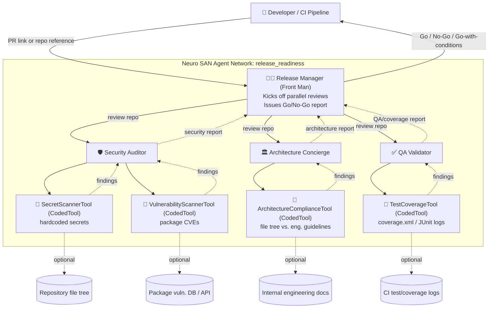

# Release Readiness Agent

A [Neuro SAN](https://github.com/cognizant-ai-lab/neuro-san-studio) multi-agent network that automates
**Enterprise Release-Readiness & Code Review**.

## The problem

Moving code from development to production requires checking security compliance, architecture standards,
and test coverage — manual checks that slow down deployment.

## The agent network

| Role | Agent | Responsibility |
|---|---|---|
| Front Man | `release_manager` (Release Manager) | Evaluates a pull request / repository link, kicks off parallel reviews, and issues a Go/No-Go readiness report. |
| Agent 1 | `security_auditor` (Security Auditor) | Scans the repository for hardcoded secrets, package vulnerabilities, and OWASP compliance issues. |
| Agent 2 | `architecture_concierge` (Architecture Concierge) | Compares the code structure against internal engineering documentation guidelines. |
| Agent 3 | `qa_validator` (QA Validator) | Reviews test execution logs to verify code coverage thresholds. |

Each reviewer agent delegates the actual repository inspection to a `CodedTool`:

- `SecretScannerTool` / `VulnerabilityScannerTool` — back `security_auditor`
- `ArchitectureComplianceTool` — backs `architecture_concierge`
- `TestCoverageTool` — backs `qa_validator`

This is the part Neuro SAN makes easy: each agent couples to a customized Python `CodedTool` that parses
raw file trees, dependency manifests, or test/coverage reports — no need to hand that logic to the LLM.

## Architecture diagram

See [`docs/architecture.mmd`](docs/architecture.mmd) for the standalone Mermaid source.



## Running it

```bash
# set your OpenAI key first (.env or environment variable OPENAI_API_KEY)
uv run ns run
```

Then open the nsflow UI and chat with the `release_readiness` network, e.g.:

> Is the repository at C:\path\to\some\repo ready to ship to production?

The Release Manager will call all three reviewer agents, each of which invokes its `CodedTool`
against the given `repo_path`, and returns a compiled Go/No-Go report.

## Project layout

```
registries/release_readiness.hocon      # the agent network definition
coded_tools/release_readiness/
    secret_scanner_tool.py               # hardcoded secret detection
    vulnerability_scanner_tool.py        # dependency CVE lookup
    architecture_compliance_tool.py      # file-tree vs. guidelines check
    test_coverage_tool.py                # coverage/JUnit report parsing
docs/architecture.mmd                    # standalone architecture diagram
```
